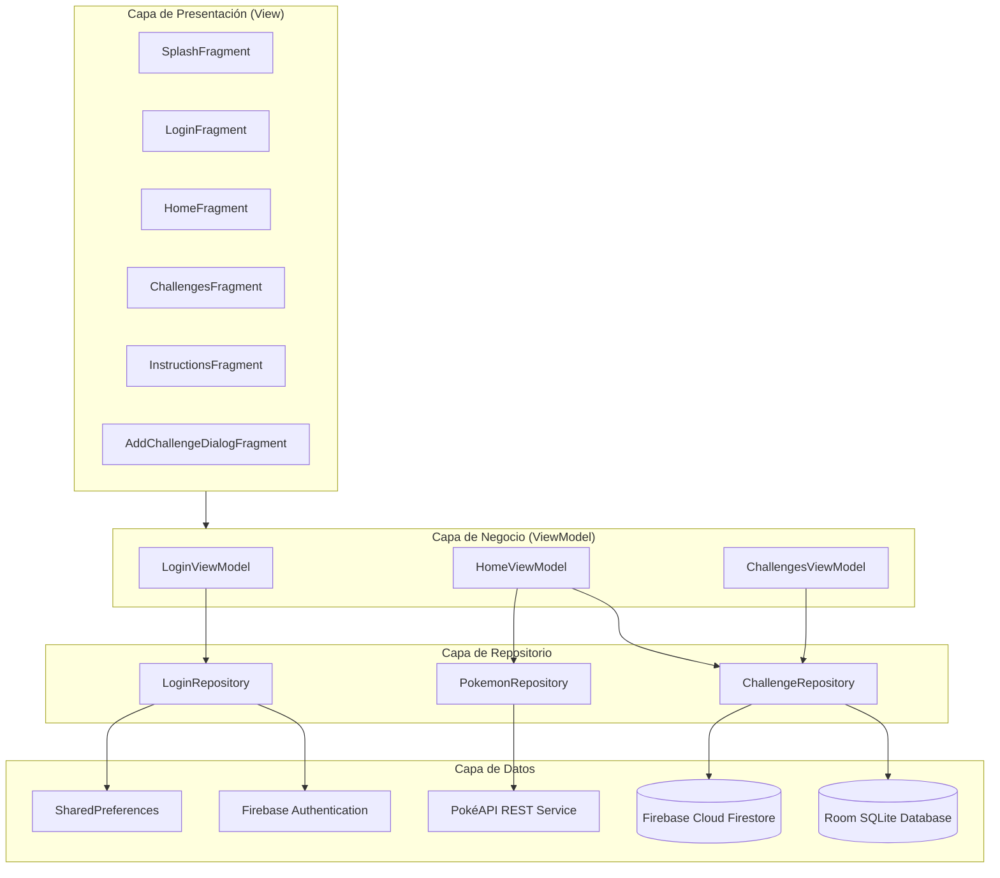

# 🍾 Pico Botella

<p align="center">
  
</p>

<p align="center">
  <strong>¡Solo los valientes lo juegan!</strong><br>
  Una experiencia interactiva y moderna del clásico juego social de la botella para Android, desarrollada con arquitectura limpia MVVM, sincronización en tiempo real y micro-animaciones inmersivas.
</p>

<p align="center">
  
  
  
  
  
  
  
</p>

---

## 📖 Tabla de Contenidos

1. [Descripción General](#-descripción-general)
2. [Características Principales](#-características-principales)
3. [Historias de Usuario (HU)](#-historias-de-usuario-hu)
4. [Arquitectura y Diseño de Software](#-arquitectura-y-diseño-de-software)
5. [Tecnologías y Dependencias](#-tecnologías-y-dependencias)
6. [Estructura del Proyecto](#-estructura-del-proyecto)
7. [Instalación y Configuración](#-instalación-y-configuración)
8. [Ejecución de Pruebas Unitarias](#-ejecución-de-pruebas-unitarias)
9. [Equipo de Desarrollo](#-equipo-de-desarrollo)

---

## 📱 Descripción General

**Pico Botella** es una aplicación móvil nativa para Android inspirada en el tradicional juego de mesa y fiesta. Incorpora el emblemático diseño de la botella de Aguardiente Amarillo, combinando animaciones fluidas con física de rotación y desaceleración, efectos sonoros reales, música ambiental y una ruleta de retos aleatorios complementada con imágenes dinámicas de personajes obtenidas desde un servicio web REST.

La aplicación garantiza disponibilidad offline gracias a su almacenamiento en SQLite mediante **Room**, complementada con sincronización bidireccional en la nube a través de **Firebase Firestore** y un sistema de autenticación de usuarios con **Firebase Authentication**.

---

## ✨ Características Principales

### 🎲 Experiencia de Juego y Física de la Botella
- **Rotación Natural**: La botella gira con un número aleatorio de vueltas y se detiene suavemente utilizando un interpolador de desaceleración (`DecelerateInterpolator`), conservando el ángulo final para giros subsecuentes.
- **Efectos Sonoros y Multimedia**: Sonido realista de giro de botella (`sonido_botella.mp3`) y música de fiesta de fondo con control de encendido/apagado en tiempo real.
- **Micro-animaciones**: Botón interactivo central con animación de parpadeo suave (`blink`) y retroalimentación táctil de escala en todos los controles del toolbar.
- **Desafío Aleatorio Sorpresa**: Al terminar el giro, un diálogo modal presenta el reto seleccionado al azar junto con un Pokémon obtenido de la PokéAPI y renderizado en alta definición mediante Glide.

### 🔐 Autenticación y Gestión de Sesión
- **Registro y Login**: Soporte completo con validación reactiva de credenciales (correo electrónico y contraseña).
- **Persistencia de Sesión**: Almacenamiento local mediante `SharedPreferences` para mantener abierta la sesión del jugador entre reinicios de la aplicación.
- **Cierre Seguro de Sesión**: Opción de Logout en la barra de herramientas que limpia credenciales locales y revoca el token en Firebase Auth.

### 📋 Gestión Dinámica de Retos (CRUD Completo)
- **Creación**: Adición de nuevos retos personalizados con validación de campos a través de un diálogo flotante.
- **Visualización Reactiva**: Listado fluido de todos los retos registrados utilizando `RecyclerView` y `CardView`.
- **Edición**: Modificación inmediata del contenido de los retos existentes.
- **Eliminación**: Diálogo de confirmación para eliminar retos de forma segura.
- **Sincronización Híbrida**: Todo cambio se replica en la base de datos local (Room) y se propaga en tiempo real hacia Firebase Cloud Firestore.

### 🛠️ Barra de Herramientas Interactiva (Toolbar)
| Botón | Acción | Descripción |
| :---: | :--- | :--- |
| 🔈/🔇 | **Audio Toggle** | Alterna la música de fondo sin interrumpir la partida. |
| ℹ️ | **Instrucciones** | Pantalla con reglas del juego y animación de trofeo triunfante. |
| ➕ | **Gestionar Retos** | Acceso directo a la administración de retos (CRUD). |
| ⭐ | **Calificar App** | Redirección a la tienda de aplicaciones. |
| 🔗 | **Compartir** | Lanzamiento del selector de compartir nativo de Android. |
| 🚪 | **Cerrar Sesión** | Desconexión segura y retorno a la pantalla de Login. |

---

## 🎯 Historias de Usuario (HU)

El desarrollo del proyecto siguió una metodología ágil estructurada en Historias de Usuario con Criterios de Aceptación verificables:

- **HU-1 & HU-2: Pantalla de Splash, Registro e Inicio de Sesión**
  - Pantalla de bienvenida con degradado premium y animación de inicio.
  - Validación de formularios reactiva con cambio de estilos visuales.
  - Manejo de excepciones de autenticación y redireccionamiento por estado de sesión.
- **HU-3: Pantalla Principal (Home)**
  - Giro interactivo y desaceleración física de la botella.
  - Sincronización entre finalización de animación y despliegue del modal de retos.
  - Control de retorno en botón atrás para salir limpiamente de la app sin volver al login.
- **HU-4: Toolbar y Micro-interacciones**
  - Implementación de animación de escala (touch feedback) al pulsar los iconos.
  - Integración de intents nativos para compartir y calificar.
- **HU-8, HU-9, HU-10 & HU-11: Administración de Desafíos**
  - Creación, lectura, actualización y eliminación de retos.
  - Detección de lista vacía con mensajes informativos al usuario.
- **HU-13: Sincronización en la Nube**
  - Sincronización en tiempo real mediante *snapshots* de Cloud Firestore a SQLite Room.

---

## 🏛️ Arquitectura y Diseño de Software

La aplicación sigue el patrón de arquitectura recomendado por Google: **MVVM (Model - View - ViewModel)** combinado con el **Patrón Repositorio**, inyección de dependencias con **Dagger Hilt** y reactividad basada en **LiveData** y **Kotlin Coroutines / Flow**.



---

## 🛠️ Tecnologías y Dependencias

| Categoría | Tecnología / Librería | Versión | Propósito |
| :--- | :--- | :--- | :--- |
| **Lenguaje** | [Kotlin](https://kotlinlang.org/) | 1.9+ | Lenguaje principal conciso y seguro |
| **Android SDK** | Compile: 35 / Min: 24 | Android 14/15 | Compatibilidad con dispositivos modernos |
| **Inyección de Dependencias** | [Dagger Hilt](https://dagger.dev/hilt/) | 2.47 | Modularidad y desacoplamiento de componentes |
| **Persistencia Local** | [Room DB](https://developer.android.com/training/data-storage/room) | KTX | Abstracción tipada sobre base de datos SQLite |
| **Cloud & Backend** | [Firebase Firestore](https://firebase.google.com/docs/firestore) | BoM | Base de datos NoSQL y sincronización en vivo |
| **Autenticación** | [Firebase Auth](https://firebase.google.com/docs/auth) | BoM | Gestión de cuentas de usuario seguras |
| **Networking** | [Retrofit 2](https://square.github.io/retrofit/) + [Gson](https://github.com/google/gson) | 2.9.0 | Consumo de API REST de Pokémon |
| **Carga de Imágenes** | [Glide](https://github.com/bumptech/glide) | 4.x | Carga y caché eficiente de avatares/imágenes |
| **Navegación** | Jetpack Navigation Component | 2.8.x | Navegación segura entre fragmentos con SafeArgs |
| **Pruebas** | JUnit 4, Mockito, Mockito-Kotlin | 5.12.0 | Pruebas unitarias de ViewModels y Repositorios |

---

## 📂 Estructura del Proyecto

```text
app/src/main/java/com/example/pico_botella/
├── PicoBotella.kt              # Clase Application con anotación @HiltAndroidApp
├── data/
│   ├── AppDatabase.kt          # Configuración de base de datos Room
│   └── ChallengeDao.kt         # Data Access Object para operaciones SQLite
├── di/
│   └── AppModule.kt            # Módulo Dagger Hilt para inyección de dependencias
├── model/
│   ├── Challenge.kt            # Entidad Room y modelo de reto para Firestore
│   ├── Pokemon.kt              # Modelo de datos de API de Pokémon
│   ├── ProductModelResponse.kt # DTO de respuesta PokéAPI
│   ├── UserRequest.kt          # Modelo de credenciales de usuario
│   └── UserResponse.kt         # DTO de resultado de autenticación
├── repository/
│   ├── ChallengeRepository.kt  # Gestión local/remota de retos
│   ├── LoginRepository.kt      # Integración con Firebase Auth y sesión
│   └── PokemonRepository.kt    # Cliente de consumo para la API de Pokémon
├── utils/
│   └── Constants.kt            # Constantes globales del proyecto
├── view/
│   ├── MainActivity.kt         # Host activity del Navigation Graph
│   ├── adapter/
│   │   └── ChallengesAdapter.kt # RecyclerView Adapter con DiffUtil
│   ├── fragment/
│   │   ├── SplashFragment.kt   # Pantalla de carga animada
│   │   ├── LoginFragment.kt    # Inicio de sesión y registro
│   │   ├── HomeFragment.kt     # Pantalla principal con la botella
│   │   ├── ChallengesFragment.kt # Lista y gestión de retos
│   │   ├── InstructionsFragment.kt # Guía y reglas del juego
│   │   └── AddChallengeDialogFragment.kt # Diálogo modal para nuevo reto
│   └── viewholder/
│       └── ChallengeViewHolder.kt # ViewHolder para elementos de la lista
├── viewmodel/
│   ├── ChallengesViewModel.kt  # Lógica de gestión de retos
│   ├── HomeViewModel.kt        # Lógica de juego, giro y audio
│   └── LoginViewModel.kt       # Lógica de autenticación y sesiones
└── webservice/
    └── ApiService.kt           # Endpoints Retrofit para la PokéAPI
```

---

## 🚀 Instalación y Configuración

### Prerrequisitos
- [Android Studio](https://developer.android.com/studio) (Koala, Ladybug o superior recomendado).
- JDK 11 o superior configurado en Gradle.
- Dispositivo Android físico con depuración USB habilitada o Emulador (API 24 o superior).

### Pasos
1. **Clonar el repositorio**:
   ```bash
   git clone https://github.com/DiegoFPC123/PicoBotella-.git
   cd PicoBotella-
   ```

2. **Configurar Firebase**:
   - Crear un proyecto en [Firebase Console](https://console.firebase.google.com/).
   - Registrar la aplicación Android con el paquete: `com.example.pico_botella`.
   - Habilitar **Email/Password** en *Authentication*.
   - Crear una base de datos en **Cloud Firestore**.
   - Descargar el archivo `google-services.json` y colocarlo en el directorio raíz del módulo:
     ```text
     PicoBotella-/app/google-services.json
     ```

3. **Compilar y sincronizar Gradle**:
   - Abrir el proyecto en Android Studio y esperar la sincronización automática de Gradle.
   - O compilar desde terminal:
     ```bash
     ./gradlew assembleDebug
     ```

4. **Ejecutar la aplicación**:
   - Seleccionar el dispositivo de destino y presionar **Run** (`Shift + F10`) en Android Studio.

---

## 🧪 Ejecución de Pruebas Unitarias

El proyecto cuenta con cobertura de pruebas unitarias sobre los ViewModels y flujos de negocio mediante `Mockito` y `InstantTaskExecutorRule`:

Para ejecutar la suite de pruebas unitarias desde la terminal:

```bash
./gradlew testDebugUnitTest
```

### Casos de Prueba Incluidos:
- ✅ Cálculo y persistencia correcta del ángulo de rotación de la botella.
- ✅ Alternancia reactiva de estados en el control de audio.
- ✅ Inserción y eliminación de retos interactuando con el repositorio simulado (`mock`).
- ✅ Validación y emisión de mensajes de error cuando no existen retos en la base de datos.
- ✅ Verificación de sesión de usuario activa mediante callbacks asíncronos.

---

## 👥 Equipo de Desarrollo

Proyecto desarrollado para el curso de Desarrollo de Aplicaciones Móviles en la **Universidad del Valle**:

| Nombre | Rol / Iniciales | Rama |
| :--- | :---: | :---: |
| **Andrés Felipe Bermúdez** | Desarrollador | `AFBG` |
| **Diego José Betancourt** | Desarrollador | `DJBV` |
| **Diego Fernando Payán** | Desarrollador | `DFPC` |
| **Wilson Johan Espinal** | Desarrollador | `WJEM` |
| **Juan Manuel Mena** | Desarrollador | `JMMM` |

---

<p align="center">
  Hecho con ❤️ y 🍾 por el equipo de Pico Botella - Universidad del Valle
</p>